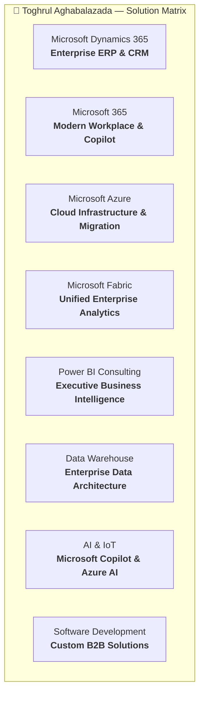

<div align="center">

# 🌐 Toghrul Aghabalazada — Enterprise Portfolio
### Sales Manager &bull; Microsoft Cloud &bull; Dynamics 365 &bull; Azure &bull; Data & AI

<p align="center">
  <a href="https://aghabalazada-toghrul.github.io/">
    
  </a>
  <a href="https://novum.tech">
    
  </a>
  <a href="https://www.linkedin.com/in/toghrul-aghabalazada-26249719a/">
    
  </a>
  <a href="https://wa.me/994702899778">
    
  </a>
</p>

<p align="center">
  
</p>

---

</div>

## 🌟 Executive Overview

Welcome to the official repository for **Toghrul Aghabalazada's** personal enterprise portfolio.

This platform showcases commercial and strategic B2B leadership across enterprise **Microsoft Cloud**, **Dynamics 365 (ERP/CRM)**, **Azure Infrastructure**, **Microsoft Fabric**, **Power BI**, and **AI/Copilot** transformations. It is engineered with modern responsive design, fluid micro-interactions, Fluent Glassmorphism, and full quadri-lingual localization (**English**, **Azərbaycan**, **Türkçe**, **Русский**).

<div align="center">

| 🌍 Region | 🏢 Key Focus | 📊 Portfolio Highlights |
| :--- | :--- | :--- |
| **Azerbaijan (Baku)** | Primary HQ &bull; Enterprise ERP/CRM | **100+** Corporate Clients Onboarded |
| **UAE (Dubai)** | GCC Enterprise Cloud Migrations | **10+** Years Commercial & B2B Experience |
| **Bahrain (Manama)** | Cloud Advisory & Power Platform | **4** Native/Fluent Languages (`AZ`, `EN`, `TR`, `RU`) |
| **Uzbekistan (Tashkent)** | Central Asia Enterprise Modernization | **100%** Vanilla JS &bull; Zero External Dependencies |

</div>

---

## 🚀 Live Multi-Language Portals

The website is deployed via GitHub Pages and features automated language routing:

| Language | Route | Direct Link |
| :--- | :--- | :--- |
| 🇬🇧 **English (Default)** | `/` | [aghabalazada-toghrul.github.io](https://aghabalazada-toghrul.github.io/) |
| 🇦🇿 **Azərbaycan dili** | `/index_az.html` (alias: `/az.html`) | [aghabalazada-toghrul.github.io/index_az.html](https://aghabalazada-toghrul.github.io/index_az.html) |
| 🇹🇷 **Türkçe** | `/index_tr.html` (alias: `/tr.html`) | [aghabalazada-toghrul.github.io/index_tr.html](https://aghabalazada-toghrul.github.io/index_tr.html) |
| 🇷🇺 **Русский** | `/index_ru.html` (alias: `/ru.html`) | [aghabalazada-toghrul.github.io/index_ru.html](https://aghabalazada-toghrul.github.io/index_ru.html) |

---

## 🛠️ Technology Portfolio & Solutions

The portfolio highlights 8 core Microsoft enterprise solutions:



---

## 🎨 Design & Architecture Highlights

- ⚡ **Zero Bloat, High Speed**: Built using pure semantic HTML5, minified Tailwind CSS (`assets/site.css`), and lightweight standalone Vanilla JS (`assets/site.js` ~11.8 KB). No jQuery, React, or bulky frameworks.
- 💎 **Fluent Glassmorphism**: Cards feature real-time pointer-tracking cursor spotlight (`--mx`, `--my`) mirroring Microsoft Fluent Design reveal highlight.
- 🎯 **Interactive Timeline**: Scroll-synchronized progress line (`--tl-progress`) that illuminates timeline milestones dynamically as the reader scrolls.
- 📈 **Animated Stat Counters**: Eased count-up animation (`100+`, `10 Yrs`, `4 Langs`) triggered on viewport entry via `IntersectionObserver`.
- 💬 **Smart WhatsApp Button**: Floating quick-contact button (`.fab-wa`) that gracefully slides in after passing the Hero section and auto-hides when the Contact section is reached.
- 📱 **Mobile-First Responsive Layout**: Floating interactive chips (`Dynamics 365`, `M365`, `Azure`, `Fabric`), accessible hamburger menu, and full responsive typography.
- 🔍 **SEO & Structured Data**: Built-in Schema.org `Person` JSON-LD microdata, canonical tags, `hreflang` alternates, `robots.txt`, and automated `sitemap.xml`.

---

## 📂 Repository Structure

```
.
├── 📄 index.html                  # English main page
├── 📄 index_az.html               # Azerbaijani localized page
├── 📄 index_tr.html               # Turkish localized page
├── 📄 index_ru.html               # Russian localized page
├── 📄 az.html / tr.html / ru.html # Short URL redirect aliases
├── 📄 robots.txt                  # Search engine crawler instructions
├── 📄 sitemap.xml                 # XML sitemap for Google Search Console
├── 📄 tailwind.novum.config.js    # Custom Tailwind styling theme
├── 📂 assets/
│   ├── 📂 css/ & site.css         # Minified production styles
│   ├── 📂 js/ & site.js           # Shared interactive behavior
│   ├── 📂 fonts/                  # Self-hosted Inter variable woff2 fonts
│   └── 📂 img/                    # Optimized portraits, badges, OG images
├── 📂 logos/                      # Verified vector logos (YIĞIM, Silk Row, Marriott, etc.)
├── 📂 src/
│   └── 📄 site.css                # Source CSS with Tailwind directives
├── 📂 tools/
│   ├── 📄 build.ps1               # Automated build & dist packaging script
│   ├── 📄 serve.ps1               # Lightweight local HTTP preview server
│   └── 📄 setup.ps1               # Environment dependencies setup
└── 📂 dist/                       # Automated deploy-ready distribution package
```

---

## 💻 Local Development & Build

### Prerequisites
- Windows PowerShell 5.1+ or PowerShell 7+
- Git

### Quick Start

1. **Clone the repository:**
   ```bash
   git clone https://github.com/aghabalazada-toghrul/aghabalazada-toghrul.github.io.git
   cd aghabalazada-toghrul.github.io
   ```

2. **Serve locally:**
   ```powershell
   powershell -ExecutionPolicy Bypass -File .\tools\serve.ps1
   # Opens http://localhost:8080 in your default browser
   ```

3. **Rebuild styles and package `dist/`:**
   ```powershell
   powershell -ExecutionPolicy Bypass -File .\tools\build.ps1
   ```

---

## 📬 Direct Contact & Inquiries

<p align="left">
  <b>Toghrul Aghabalazada</b><br>
  Sales Manager &bull; NOVUM Information Technology (NOVUM Tech)<br>
  📍 Baku, Azerbaijan &bull; Dubai, UAE &bull; Manama, Bahrain &bull; Tashkent, Uzbekistan
</p>

<p align="left">
  <a href="mailto:toghrul.aghabalazada@novum.tech">
    
  </a>
  <a href="mailto:toghrulaghabalazada@gmail.com">
    
  </a>
  <a href="https://wa.me/994702899778">
    
  </a>
  <a href="https://www.linkedin.com/in/toghrul-aghabalazada-26249719a/">
    
  </a>
</p>

---

<div align="center">
  <sub>&copy; 2026 Toghrul Aghabalazada. Personal Portfolio. Not affiliated with or endorsed by Microsoft Corporation.</sub>
</div>
